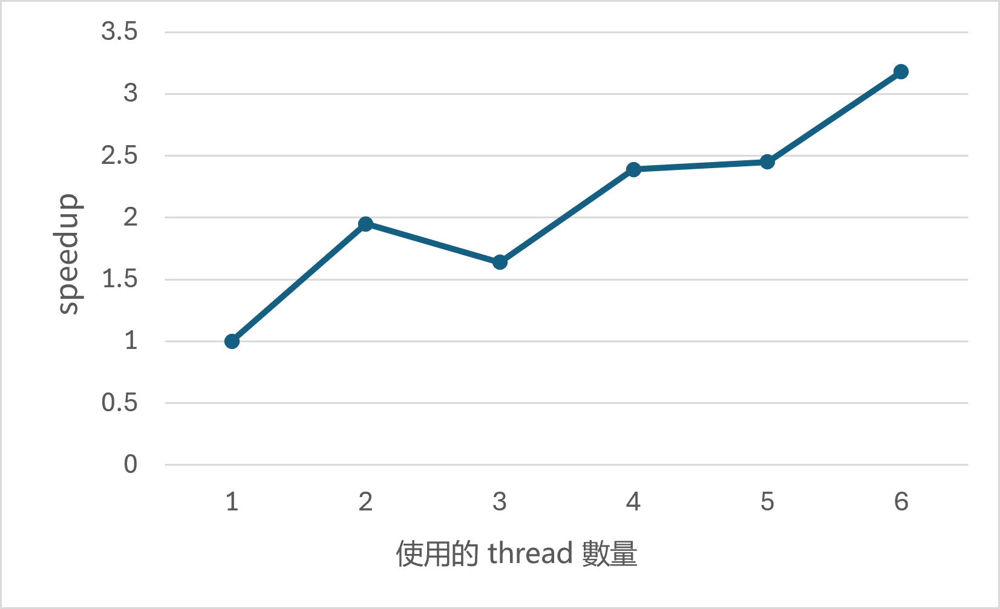
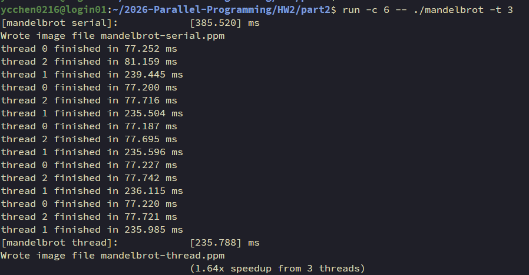
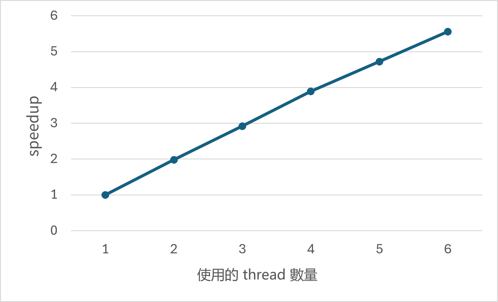
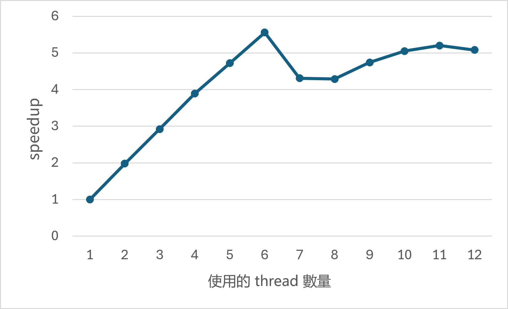

# Programming Assignment II: Multi-thread Programming

## Q1

### In your write-up, plot a graph of speedup (compared to the reference sequential implementation) as a function of the number of threads used for VIEW 1. Is the speedup linear to the number of threads used? Hypothesize why this is (or is not) the case. (You may want to plot a graph for VIEW 2 for further insights.)


我的程式碼如下：
```c++
void worker_thread_start(WorkerArgs *const args){
    int start_row, total_rows;
    start_row = (args->height / args->numThreads) * args->threadId;
    if (args->threadId == args->numThreads - 1){
        total_rows = args->height - start_row;
    }else{
        total_rows = args->height / args->numThreads;
    }
    mandelbrot_serial(args->x0, args->y0, args->x1, args->y1, args->width, args->height, start_row, total_rows, args->maxIterations, args->output);
}
```

實作時，我將影像由上而下切分成數個連續的 row 區段，讓每個 thread 負責其中一段。各 thread 分配到的列數盡可能相同，剩餘的列則由最後一個 thread 計算。

不同 thread 數量下的 speedup 如下圖：



從圖中可以看出，使用 3 個 thread 時的 speedup 低於使用 2 個 thread 時的結果。因此，這組測量結果並未呈現 speedup 隨 thread 數量線性增加的趨勢。可能的原因是各 thread 的實際計算量不同，導致部分 thread 必須花較久時間完成工作；Q2 將進一步檢視這個可能性。

## Q2

### How do the measurements explain the speedup graph you previously plotted?

我在 `worker_thread_start` 中記錄各 thread 執行 `mandelbrot_serial` 的時間。當使用 3 個 thread 時，thread 1 的執行時間明顯較長，如下圖所示：



再查看各 thread 負責區域所生成的圖片，可以看到 thread 1 的區域中，白色像素的比例較高：

thread 0:


thread 1:


thread 2:


在輸出圖片中，像素亮度會隨該像素的 iteration 次數增加。

而 `mandel` 函數會反覆計算，直到 `z_re * z_re + z_im * z_im > 4.f`，或達到最大 iteration 次數。因此，較亮的區域表示這些像素需要較多次迭代才停止，或在上限內沒有觸發停止條件。這讓 thread 1 的較長執行時間與其負責區域中較多的高 iteration 像素相互吻合，顯示各區域的工作量可能不均。

由於影像是按列切分，像素數量相近不代表所需的迭代次數相近。若 thread 1 負責的區域需要較多計算，其他 thread 即使較早完成，整體執行時間仍會受到較慢 thread 的限制。這可能解釋為何使用 3 個 thread 時的 speedup 反而低於使用 2 個 thread 的結果。

## Q3

### In your write-up, describe your parallelization approach and report the final speedup achieved with 4 threads.

我將原本按連續區段分配的方式，改為逐 row 以 round-robin 方式分配工作。

```c++
for(int i = args->threadId ; i < args->height; i+=args->numThreads){
    mandelbrot_serial(args->x0, args->y0, args->x1, args->y1, args->width, args->height, i, 1, args->maxIterations, args->output);
}
```

這種分配方式的目標是讓 Q2 中計算量較高的中間區域會分散給多個 thread 處理，有助於減少單一 thread 承擔過多工作的情形。

修改後的 speedup 如下圖所示。在這組測量結果中，speedup 隨 thread 數量增加而呈現接近線性的成長趨勢。



## Q4

### Is the performance noticeably better than with 6 threads? Why or why not?

從下圖可以看出，在這組測量結果中，使用超過 6 個 thread 時，speedup 均低於使用 6 個 thread 的結果。因此，繼續增加 thread 數量並未帶來更好的效能。



由於實驗環境只有 6 個實體核心，當 thread 數量超過 6 時，各 thread 可能需要競爭核心的運算資源，並增加排程與 context switch 的額外成本。這些因素可能抵銷增加 thread 所帶來的效益，使效能無法進一步提升。
